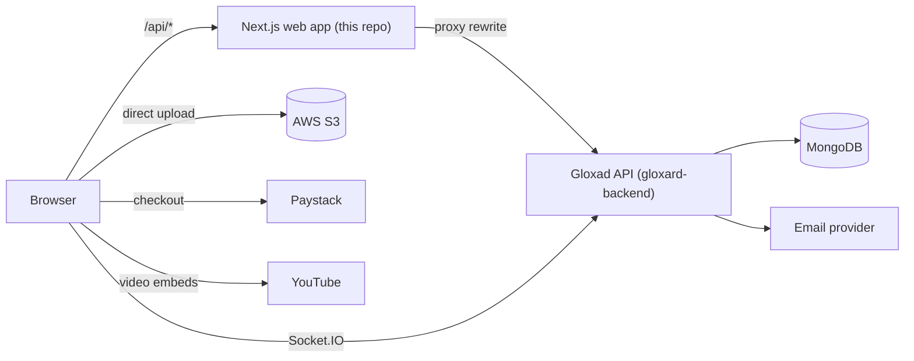
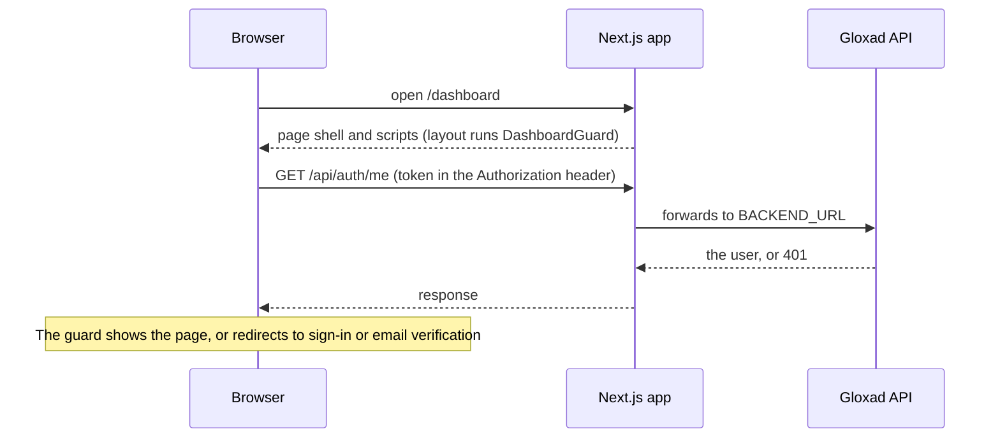
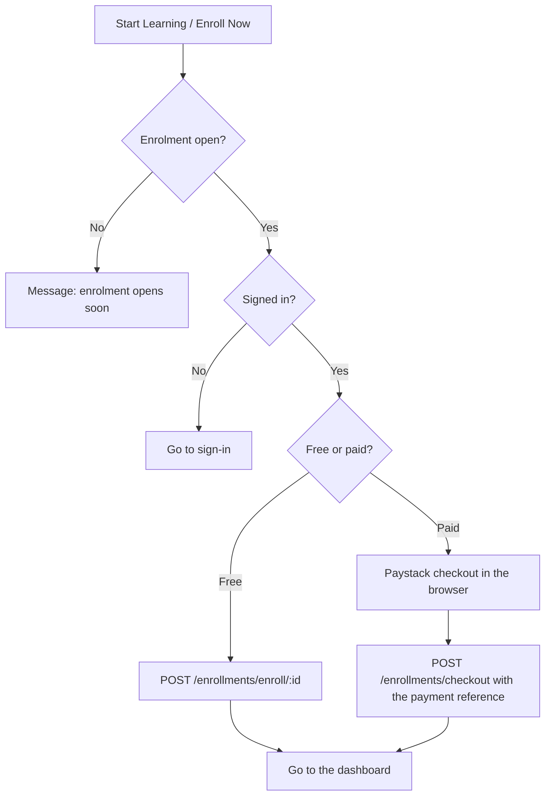

<p align="center">
  <picture>
    <source media="(prefers-color-scheme: dark)" srcset="docs/assets/gloxad-logo-white.png">
    
  </picture>
</p>

<h1 align="center">Gloxad Academy: Web App</h1>

<p align="center">
  <strong>Where Learning Meets Opportunity</strong><br>
  The website, student and tutor dashboards, admin area, partner portal and trimester LMS for Gloxad Academy.
</p>

---

## Contents

1. [About Gloxad Academy](#about-gloxad-academy)
2. [What is in this app](#what-is-in-this-app)
3. [How the system fits together](#how-the-system-fits-together)
4. [How it works](#how-it-works)
5. [Tech stack](#tech-stack)
6. [Getting started](#getting-started)
7. [Environment variables](#environment-variables)
8. [Scripts](#scripts)
9. [Project structure](#project-structure)
10. [Routes and access](#routes-and-access)
11. [Authentication and roles](#authentication-and-roles)
12. [The course catalogue and free courses](#the-course-catalogue-and-free-courses)
13. [Testing](#testing)
14. [Building and deploying](#building-and-deploying)
15. [Contributing](#contributing)
16. [Documentation](#documentation)
17. [Known issues and roadmap](#known-issues-and-roadmap)
18. [Related repositories](#related-repositories)

---

## About Gloxad Academy

Gloxad Academy is an online academy that teaches practical technology and business skills. It is built with Nigerian learners in mind: prices are in Naira, there is an NYSC tech-training track, and cohort schedules use West Africa Time. It serves four groups of people:

| Who | What they do on the platform |
| --- | --- |
| **Learners** | Browse courses, learn from video lessons, take quizzes, track progress, earn certificates, join a trimester cohort |
| **Tutors** | Apply to teach, build and submit courses, reply to reviews, message learners, see earnings |
| **Administrators** | Approve tutors and courses, manage users and categories, handle appeals, watch finance and platform settings |
| **Partner institutions** | Apply to partner with Gloxad, onboard departments, tutors and students, and manage their own workspace |

### What can be learned

The catalogue has **74 free courses in 10 categories**: Software Development, Design, Data Science and Analytics, Artificial Intelligence, Cloud and Cybersecurity, Marketing and Sales, Business and Entrepreneurship, Blockchain, Foundations, and Test Preparation.

Courses are offered in several formats:

- **Academic programmes**, with a pathway from Certificate to Professional Certificate to Diploma
- **Short courses** and **monthly programmes**
- **Bootcamps** and **training programmes**
- **NYSC tech training** and a **secondary-school technology programme**

The video lessons come from [freeCodeCamp.org](https://www.youtube.com/@freecodecamp) on YouTube and are played in YouTube's own player, with the creator credited on every course page.

---

## What is in this app

| Area | What it includes |
| --- | --- |
| **Public site** | Home page with category tabs, free courses, the course catalogue and course pages, the trimester programme page, tutor and institution landing pages, sign-in and sign-up |
| **Student dashboard** | My courses, free courses, trimester courses, certificates, notifications, messages, settings |
| **Course player** | Lessons with saved progress, notes and questions, server-scored quizzes, a completion page and a downloadable certificate |
| **Tutor area** | Dashboard, a step-by-step course upload wizard, credential verification, earnings, reviews, messages |
| **Admin area** | Courses, tutors, students, reviews, finance, live classes, platform settings |
| **Institution module** | Landing page, application, a six-step onboarding wizard (logo, departments, tutors, students, subscription, branding), and an institution dashboard. These screens are designed and built, and run on demo data until the backend endpoints exist. |
| **Trimester LMS** (`/lms`) | Dashboard, weekly curriculum, live classes with chat, polls and a shared code editor, coding labs, quizzes, assignments, community, certificates and help |
| **Payments** | Paystack checkout for paid courses, with success and failure pages |
| **Real time** | Direct messages, notifications and live-class events over Socket.IO |

---

## How the system fits together



- The web app has **no database of its own**. It calls the Gloxad API for accounts, courses, enrolments, payments and files.
- Calls to `/api/*` on the web app are forwarded to the API by a rewrite in `next.config.mjs`, so the browser only ever talks to one address.
- The **74 catalogue courses are bundled** with the app. The site shows them straight away, even if the API is slow or does not have them yet, and replaces them with the API copy when it arrives.

---

## How it works

This section explains what happens inside the app, step by step. API addresses are relative to `/api`.

### 1. From the address bar to the API



- Next.js serves the page shell, the page title and the bundled catalogue pages. Almost everything else runs in the browser.
- Each screen asks for its data with **React Query**, which caches results by key and re-uses them. Local screen state stays in the component. There is no global store.
- Every request goes through one Axios client, which adds the token, retries once after a 401 by refreshing the token, and talks to `/api` on the same address as the site.

### 2. Accounts: sign up, verify, sign in, sign out

1. **Sign up** (`POST /auth/signup`). The API creates the account (tutors start as `pending`), emails a 4-digit code that lasts 15 minutes, and **returns a token straight away**, so the new user is already signed in but marked unverified.
2. **Verify.** Because the user is unverified, `DashboardGuard` sends them to `/auth/verify-otp`. They enter the code (`POST /auth/verify-email`, five tries per code). The API marks the email verified and sends the welcome email. Students can skip verification only if `NEXT_PUBLIC_REQUIRE_STUDENT_EMAIL_VERIFICATION` is `false`.
3. **Sign in** (`POST /auth/signin`) takes an email or a username. The token is saved in `localStorage` and `useAuth` loads the profile from `GET /auth/me`. `getPostAuthRoute` then decides where the user goes: admins to `/admin`, unapproved tutors to `/tutor/onboarding`, everyone else to the page they asked for or `/dashboard`.
4. **Stay signed in.** Tokens last 7 days. If a request returns 401, the client calls `POST /auth/refresh`, which accepts a token that expired in the last five minutes, then repeats the request.
5. **Sign out** (`POST /auth/signout`) does more than clear the browser: the API raises the account's `tokenVersion`, which signs the user out **on every device**.
6. **Forgot password.** `POST /auth/forget-passwd` emails a 5-digit code, `POST /auth/verify-otp` checks it, and `POST /auth/reset-passwd` sets the new password and signs out all other sessions. The first step always says "if the account exists" so nobody can test which emails are registered.

### 3. Browsing courses

- **Course list** (`/courses`, signed-in users). `useCoursesPage` asks the API (`GET /courses`, with search and category, waiting 350 ms after typing and giving up after 8 seconds) and, at the same time, filters the **bundled catalogue** in the browser. The two lists are merged and matched by title, so a course is never shown twice. The page shows catalogue courses at once; API courses appear when they arrive.
- **Course page** (`/courses/[slug]`). The page is pre-built with the catalogue copy, so it appears immediately. In the background it asks `GET /courses/:slug`, and if the API has the course, that copy replaces the bundled one. A course is **free** when `courseType` is `free` (or its price is 0), and uses the free layout; otherwise it uses the paid layout.
- **Videos.** Lessons play in YouTube's privacy-enhanced player (`LessonVideo`). The API hides a lesson's video address from people who have not enrolled, unless the lesson is marked as a free preview. Every catalogue lesson is a free preview.

### 4. Enrolling and paying



- **Free:** one call enrols the student. The API refuses if the course is not published, is not free, or has enrolment switched off.
- **Paid:** the student pays inside Paystack's window. The app then sends the payment reference, and the API checks it with Paystack, confirms the amount, and records the sale (70% to the tutor, 30% to Gloxad). Paystack also notifies the API by webhook, so a payment is not lost if the student closes the tab.
- A course that exists only in the bundled catalogue (not yet in the database) cannot be enrolled in yet.

### 5. Learning

Starting a course:

1. **Start Learning** enrols the learner (`POST /enrollments/enroll/:id`, safe to repeat) and opens the course player at `/learning/<course id>`. A course that exists only in the bundled catalogue cannot be enrolled in yet, and the page says so.
2. **Courses are built from the videos' own chapters.** Each catalogue course has one **module per YouTube video** and one **lesson per chapter** of that video, using the chapters the creator published on YouTube. A lesson knows its video, its start time and its end time. A 4-hour video with 35 chapters becomes a module with 35 lessons, each with its timestamp.
3. **The course page** (`/courses/<slug>`) embeds the actual video in YouTube's own player, lists every module and chapter with its start time, and plays any chapter you click from its start time. Before enrolling, anyone can preview the chapters.
4. **The player** (`/learning/<id>`) loads the learner's enrolment (`GET /enrollments/my-courses`, which answers `{ enrollments, pagination }`) and the course (`GET /courses/:id`, which answers `{ course, isEnrolled }`). It resumes the chapter the learner stopped at, at the second they stopped.
5. **Progress is tracked live as the video plays.** The player uses YouTube's official IFrame Player API to read the playback time once a second:
   - The highlighted chapter in the list **follows the video**, like YouTube's own chapters.
   - A chapter is marked **complete when playback runs past its end**. Jumping around the timeline does **not** count, so a chapter must actually be watched. The progress bar, the tick and the module count (such as "1 / 35") update at that moment, and the API saves it (`POST /learning/:courseId/progress`).
   - The current position is saved every 15 seconds and whenever the learner pauses or picks a chapter, so **Resume** returns to the same second.
   - Clicking a chapter in the same video jumps the player to it. A chapter in another video loads that video. When a video ends, the next lesson starts.
   - **Mark as complete** and **Complete and continue** finish a chapter by hand. **My Courses** and the **Continue learning** card read the same saved numbers.
6. **Quizzes** appear in the lesson list. The quiz page shows the quiz's real questions and sends only the chosen option for each (`POST /learning/:courseId/quiz/:quizId/submit` with an `answers` list). **The API scores it**, because it never sends the answer key to learners, and the page shows the API's result: score, pass mark, and correct, incorrect and skipped counts. A failed quiz can be retaken. The page's 15-minute timer is a page feature, not enforced by the API.
7. **Certificates.** A finished course opens `/learning/[id]/certificate`, where the certificate is **built in the browser** (`html2canvas` and `jspdf`) and downloaded as a PDF. The Certificates tab on **My Courses** lists the learner's real completed courses.
8. **Questions and notes.** The player lets the learner post lesson questions and private notes.

### 6. Teaching

1. A tutor signs up (`role=instructor`) and lands on `/tutor/onboarding`. They upload certificates and proof of experience straight to S3, then submit them (`POST /tutor/showcase-expertise`).
2. An admin reviews them in the admin area (`PUT /admin/tutors/:id/approval`). Until the tutor is **approved**, the upload form is locked.
3. The upload wizard has four steps: **Basic information**, **Advanced information**, **Curriculum builder** and **Publish**. The first save creates a **draft** (`POST /tutor/courses`), and each later step updates it (`PUT /tutor/courses/:id`). Images and videos go to S3 (see uploads below).
4. **Publish** submits the draft for review (`POST /tutor/courses/:id/submit`), which moves it to `pending`.
5. An admin approves it (it becomes `published` and appears in the catalogue) or rejects it with a reason. A rejected course can be appealed (`POST /tutor/courses/:id/appeal`), and an admin resolves the appeal.

### 7. The trimester LMS

`/lms` is guarded by `RoleGuard` (sign-in required) and `DashboardRouter` shows the student, instructor or admin dashboard by role. Cohort membership is decided by the API: a student sees only the cohort they belong to.

| Screen | Data |
| --- | --- |
| Student dashboard, weekly path, live class, coding labs, help center | **Real API data** (`/lms/*`) |
| Lesson page, quiz, assignments, community, certificates, instructor dashboard, admin dashboard | **Built-in sample content** (`src/views/Lms/data.ts`). The API has no endpoints for them yet. |

- **Live class.** Joining (`POST /lms/live-sessions/:id/join`) returns the class's YouTube stream, which plays in the embed. Chat, polls, the people list and the shared code panel work by **asking the API again every few seconds** (between 2.5 and 20 seconds). The page does not use the live `/live` socket channel yet.
- **Coding labs** run the learner's JavaScript in a **Web Worker** in the browser, so it cannot touch the page and an endless loop can be stopped. The result is then reported to the API (`POST /lms/code-labs/:slug/submissions`). The API stores it as **unverified**, because there is no server-side check yet.
- **Demo mode.** A demo login has no backend account, so these screens show their sample content instead of calling the API.

### 8. Messages and notifications

`useSocket` opens one Socket.IO connection per signed-in user, sends the token with the handshake, and keeps it open for the whole session. The server puts the connection in a private room for that user. The Messages pages and the admin notification center listen on it for new messages and notifications.

### 9. Uploads

1. The page asks `POST /upload/presigned-url` for a short-lived upload address (folder, file name and type).
2. The browser sends the file **directly to Amazon S3** with a plain request. The Authorization header is deliberately left off, because it would break S3's signature.
3. The returned file address is saved on the record (profile photo, course thumbnail, lesson video and so on).

The API never receives the file itself, which keeps large videos off the server.

---

## Tech stack

| Layer | Choice |
| --- | --- |
| Framework | Next.js 14 (App Router) with React 18 |
| Language | TypeScript 5 (strict) |
| Styling | Tailwind CSS 3 with a custom type scale and colours, Roboto and DM Sans fonts |
| Data | TanStack React Query 5 and Axios |
| Forms | React Hook Form, `react-phone-number-input`, `react-pin-input` |
| UI and motion | Framer Motion, Lenis smooth scroll, `react-icons`, `react-toastify`, Recharts, `@hello-pangea/dnd` |
| Real time | `socket.io-client` |
| Payments | `react-paystack` |
| Rich content | `react-quill`, CodeMirror (live code panel), `jspdf` and `html2canvas` (certificates) |
| Tests | Jest 29, Testing Library, MSW |

---

## Getting started

You need **Node.js** (a current LTS release) and **npm**.

```bash
git clone https://github.com/Gloxad-Academyteam/Gloxadapp.git
cd Gloxadapp
npm install
cp .env.example .env.local
npm run dev
```

Open <http://localhost:3000>.

- With the default settings the app talks to the live API on Render. That server sleeps when idle, so the first request after a quiet period can take up to a minute. The catalogue courses still appear immediately.
- Run `npm install` after every pull. The live-class page needs the CodeMirror packages, and the dev server shows errors without them.

### Running against a local backend

Start [`gloxard-backend`](https://github.com/Jester8/gloxard-backend) (see its README), then:

```bash
BACKEND_URL=http://localhost:3001 npm run dev
```

---

## Environment variables

Copy `.env.example` to `.env.local`. Real `.env` files are ignored by Git. **Never commit secrets.** This app needs none: payment, email and storage secrets live in the backend.

| Variable | Purpose | Default and notes |
| --- | --- | --- |
| `BACKEND_URL` | Where `/api/*` requests are forwarded | `https://gloxard-backend.onrender.com` |
| `NEXT_PUBLIC_BACKEND_URL` | Address Socket.IO connects to directly | Same as `BACKEND_URL`. Must allow WebSockets. |
| `NEXT_PUBLIC_REQUIRE_STUDENT_EMAIL_VERIFICATION` | Students must verify their email before the dashboard | `true`. Use `false` only if the API does not email codes to students. |
| `NEXT_PUBLIC_API_URL` | Optional. Calls the API directly and skips the proxy | Unset. The API then needs CORS for this site. |
| `NEXT_PUBLIC_PAYSTACK_PUBLIC_KEY` | Paystack public key for checkout | Falls back to a dummy test key, so paid checkout will not work until it is set. |
| `NEXT_PUBLIC_ENABLE_DEMO_LOGIN` | Turns on browser-only demo accounts in a production build | Unset. Demo login is on in development and off in production. **Never set it in production.** |

> Variables that start with `NEXT_PUBLIC_` are written into the site **when it is built**. Changing one on the hosting service has no effect until you build again. `BACKEND_URL` behaves the same way in a production build.

---

## Scripts

| Command | What it does |
| --- | --- |
| `npm run dev` | Development server on port 3000 |
| `npm run build` | Production build (uses up to 4 GB of memory) |
| `npm start` | Runs the production build |
| `npm run lint` | `next lint` |
| `npm test` | Runs the Jest tests |
| `npm run test:watch` / `npm run test:coverage` | Watch mode / coverage report |
| `node scripts/build-course-seed.mjs` | Builds the backend course seed in `docs/course-seed/` from the catalogue JSON |
| `python3 scripts/update-catalog-chapters.py` | Reads each catalogue video's chapters from YouTube into `gloxadChapters.json`. Add `--backend <path>` to write the backend's merged copy. |

---

## Project structure

```text
Gloxadapp/
  src/
    app/          Next.js routes: thin pages that render a view
    views/        One folder per screen or feature (the page's real content)
    components/   Shared UI: Header, Footer, Button, Modal, guards, ...
    services/     API calls, one folder per backend area, plus the catalogue
    hooks/        useAuth, useSocket, useS3Upload, ...
    utils/        Axios client, route helpers, formatters, colours
    constants/    Routes, shared data, the bundled course catalogue JSON
    assets/       Images and videos
  public/         Static files: logo, favicon, sitemap, email images
  docs/           Team documents, backend hand-off patch, course seed
  scripts/        build-course-seed.mjs, update-catalog-chapters.py
  amplify.yml     AWS Amplify build settings
  next.config.mjs Proxy to the backend API
```

**How a page is built.** A file in `src/app/<route>/page.tsx` sets the title and description and renders a component from `src/views/`. Put a screen's content in `views`, not in `app`.

**Import aliases:** `@components/*`, `@pages/*` (which means `src/views/*`), `@services/*`, `@hooks/*`, `@utils/*`, `@constants/*`, `@assets/*`.

---

## Routes and access

| Area | Routes | Who can open it |
| --- | --- | --- |
| Public | `/`, `/free`, `/courses/[slug]`, `/trimester`, `/teach`, `/scholarships` (coming soon), payment result pages | Anyone |
| Course list | `/courses` | Signed-in users. Visitors are sent to sign-in and returned afterwards. |
| Authentication | `/auth/signin`, `/auth/signup`, `/auth/verify-otp`, `/auth/forgot-password`, `/auth/reset-password` | Anyone. Signed-in users are redirected away. |
| Dashboard | `/dashboard/*` | Signed-in users with a verified email |
| Learning | `/learning/[id]`, quiz, completion, certificate; `/checkout/[id]` | Rely on the API refusing signed-out requests |
| Tutor onboarding | `/tutor/onboarding` | Instructors only |
| Admin | `/admin/*` | Role `admin` only (`/admin/login` is open) |
| Trimester LMS | `/lms/*` | Signed-in users. Not indexed by search engines. |
| Institution | `/institution/*` | Currently open (demo data) |

Folders in brackets such as `(public)` and `(protected)` only share a layout. They do not appear in the address.

---

## Authentication and roles

- **Token.** After sign-in the API returns a token. The app keeps it in `localStorage` (key `token`) and sends it as `Authorization: Bearer <token>` on every request.
- **Refresh.** On a 401 the client tries `POST /auth/refresh` once and repeats the request. If the API has no refresh route (404), the client stops trying.
- **Who is signed in.** The `useAuth` hook calls `GET /auth/me` through React Query.
- **Roles:** `student`, `instructor` (tutor) and `admin`.
- **Guards** (set in a folder's `layout.tsx`):
  - `DashboardGuard`: sign-in and a verified email.
  - `RoleGuard`: sign-in, a verified email, and optionally a role. `returnAfterLogin` sends visitors back where they were going.
  - `AuthGuard`: for sign-in and sign-up pages. It honours a `?redirect=` value only when it is a path on this site.
- **After sign-in:** admins go to `/admin`. Instructors who are not approved go to `/tutor/onboarding`. Everyone else goes to the redirect address or `/dashboard`.
- **Email verification** is always required for tutors, and for students unless `NEXT_PUBLIC_REQUIRE_STUDENT_EMAIL_VERIFICATION` is `false`.
- **Demo login** (development only by default) opens the dashboards without a backend account. See `src/utils/demoAuth.ts`.

---

## The course catalogue and free courses

- The data lives in `src/constants/catalog/gloxadCourses.json`: 74 courses, 10 categories, and 340 video entries (206 different freeCodeCamp videos). **All courses are free.**
- Each video's **chapters** (5,845 in total) are in a separate file, `src/constants/catalog/gloxadChapters.json`, keyed by YouTube id. It is loaded only on course pages, so the course lists stay light. A course page shows each video as a single lesson for a moment, then rebuilds its modules from the chapters as soon as the file loads.
- To refresh the chapters, run `python3 scripts/update-catalog-chapters.py`. It reads each video's public YouTube page slowly, to avoid being blocked.
- `src/services/catalog/index.ts` converts each entry into the same shape the API uses, so the existing cards and pages work unchanged. A catalogue course has `_id: catalog-<slug>` and `isCatalog: true`.
- A course is free when its price is `0`. Free courses use the free layout and the **Free Courses** page (`/free`).
- The course list merges API courses with catalogue courses by title, so nothing appears twice.
- The backend has its own copy of the catalogue (with the chapters included) and an import script, so the courses exist in the database too. After changing the catalogue or the chapters, run `python3 scripts/update-catalog-chapters.py --backend ../gloxard-backend/src/data/gloxadCourses2026.json`, then `npm run catalog:import` in the backend.

### Rules for third-party videos

These come from the team's YouTube embedding guidelines:

- Free access only. No price, paywall or upsell on a third-party video.
- Use the original YouTube player. Never download, copy or re-host a video.
- Credit the creator, show the source link, and make clear Gloxad does not own the content.
- Do not require a like, subscribe or comment to watch.
- Keep a register of every video (title, creator, link, date checked, embedding tested, approver).
- **YouTube API terms.** Live tracking uses YouTube's IFrame Player API, which counts as using YouTube API Services. The team's guidelines require the technical lead to review YouTube's API terms and developer policies, and the privacy disclosures they ask for, before this goes live. The player's controls, ads and branding are left untouched.

---

## Testing

```bash
npm test
```

> **Known problem:** on 28 October 2026 all 15 test suites fail before running with `Unexpected token '<'`, because Jest has no TypeScript and JSX transform. Fixing the Jest set-up is the first item on the roadmap below.

Before opening a pull request, also run `npx tsc --noEmit` and `npm run build`, then open the production build with `npm start` and check the pages you changed at phone width (375 px) and desktop width (1280 px).

---

## Building and deploying

```bash
npm run build && npm start
```

The production build also finds errors that development mode hides, such as code that touches `window` when it loads. Load browser-only libraries (Paystack, the code editor) with `next/dynamic` and `{ ssr: false }`.

`amplify.yml` contains build settings for AWS Amplify: install with `npm ci`, build with `npm run build`, publish `.next`. Where the live site is hosted is not recorded in this repository, so confirm the host before changing deployment settings. Whatever the host, set `BACKEND_URL`, `NEXT_PUBLIC_BACKEND_URL` and `NEXT_PUBLIC_PAYSTACK_PUBLIC_KEY` before building, and make sure `NEXT_PUBLIC_ENABLE_DEMO_LOGIN` is **not** set.

---

## Contributing

The full guide is in [CONTRIBUTE.md](CONTRIBUTE.md). In short:

- Never push straight to `main`, and never merge a pull request without approval.
- Branch names: `<ft|bg|rf>-#ticket-id-<title>` (feature, bug fix, refactor), for example `ft-#675-add-button-component`.
- Commit messages: `<ft|bg|rf>-#ticket-id: <short description>`.
- Pull request title: `[#675] Add prettier configuration`, with the Trello ticket linked in the body. Ask a reviewer, assign yourself, merge only after approval.

Code conventions:

- Keep `src/app` pages thin and put content in `src/views`.
- Add `"use client"` to any file that uses state, effects or browser APIs.
- Fetch server data with React Query and the shared Axios client, and put new API calls in `src/services/`.
- Protect a group of pages with a guard in `layout.tsx`.
- Design mobile first, then add `sm:`, `md:`, `lg:` changes.
- Show an empty state for missing data. Never show invented numbers, ratings or testimonials.

---

## Documentation

Team documents are in [`docs/`](docs/):

| File | What it is |
| --- | --- |
| `Gloxad-Backend-Requirements.pdf` | What the web app needs from the API (7 October 2026) |
| `Gloxad-Backend-Requirements-Next-Steps.pdf` | The updated, phase-by-phase backend plan (27 October 2026) |
| `Gloxad-API-Integration-Report.pdf` | What was integrated with the API and what was missing |
| `backend-handoff/` | The backend patch for the course catalogue |
| `course-seed/` | The generated course seed for the database |

---

## Known issues and roadmap

- [ ] Connect the LMS lesson, quiz, assignments, community, certificates and instructor and admin dashboards to the API as the endpoints appear.
- [ ] Move live-class chat and polls from polling to the `/live` socket channel.
- [ ] Fix the Jest set-up so the tests run, then add tests for the course pages and guards.
- [ ] Add an ESLint configuration (there is none, so `npm run lint` enforces nothing).
- [ ] Add a GitHub Actions workflow that runs type-check, lint, test and build on every pull request.
- [ ] Protect `main` and require reviews.
- [ ] Add a sign-in check to `/learning/[id]`, `/checkout/[id]` and the institution portal.
- [ ] Footer: real social links and the registered company name.
- [ ] A trimester application path for students who are not in a cohort.
- [ ] A unique page title for every page.
- [ ] Test embedding for every catalogue video and keep the content register.
- [ ] Connect the institution module to real endpoints once the backend provides them.
- [ ] Remove the leftover `react-router-dom` imports (five components) that do not belong in a Next.js app.

---

## Related repositories

| Repository | Purpose |
| --- | --- |
| [`Gloxad-Academyteam/Gloxadapp`](https://github.com/Gloxad-Academyteam/Gloxadapp) | This web app |
| [`Jester8/gloxard-backend`](https://github.com/Jester8/gloxard-backend) | The Gloxad API (Node.js, Express, MongoDB) |

No license file has been chosen yet. Until one is added, ask the team before reusing this code.

<p align="center"><sub>© 2026 Gloxad Academy</sub></p>
